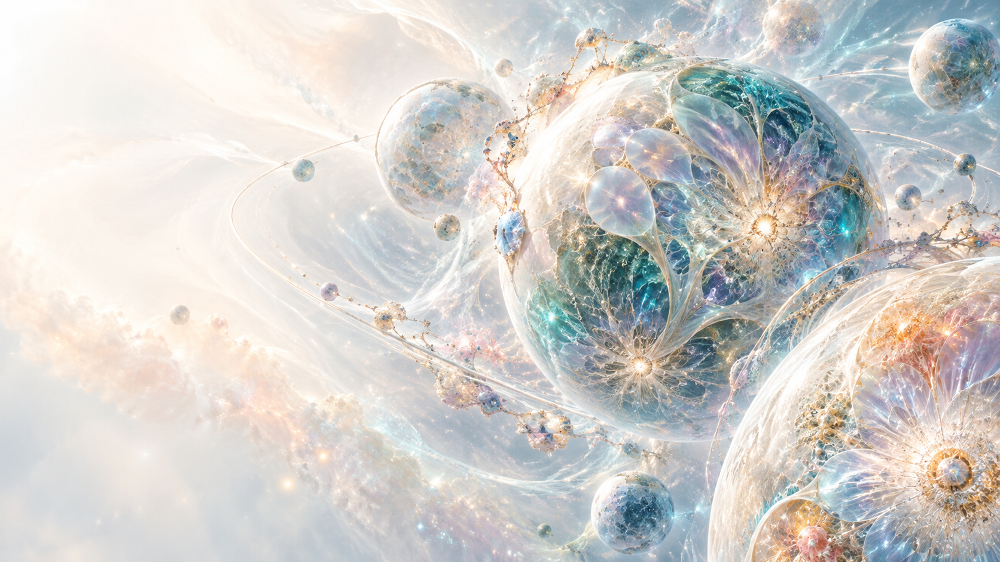

# AJ 생태적 우주 아트디렉션

> 현재 상태 갱신 · 2026-10-13: 메인 페이지, Three.js 기반 연속 WebGL 배경·스크롤 연출, 실제 작품 탐색과 별도 Resume의 로컬 구현이 있습니다. 브라우저 검수는 진행 중이며 아직 완료로 기록하지 않습니다. 현재 파일·실행 방법·자산 상태는 [README](README.md)를 참고하세요. 아래 본문은 구현 전 준비 기록을 보존한 것으로, 당시의 미착수·다음 단계 표기는 현재 구현 상태를 뜻하지 않습니다.

- 작성일: 2026-10-13
- 상태: 아트 방향을 로컬 WebGL 씬에 반영. 생성형 임시 키프레임과 아트 기준을 보존하며 브라우저 검수 진행 중.
- 대상: Artweaver Jay / AJ 브랜드 페이지의 연속 배경과 스크롤 키프레임

## 참조를 살펴본 범위

[Florigenix (@florigenix_ai)](https://www.instagram.com/florigenix_ai/) 공개 프로필의 최신 고정 게시물, 로드된 게시물 그리드, 화면에 표시된 캡션과 일부 중간 게시물의 캡션을 2026-10-13에 살펴봤다. 프로필 전체 1,224개 게시물을 전수 검토한 것은 아니다. 게시물 설명에 반복되는 주제는 꿈의 세계, 생태·우주적 존재, 빛의 몸과 별 지도, 재귀적 생명 코드, 포자·숲·수중 풍경, 서로 다른 종의 공존이다. 시각적으로는 방사형 점광원, 가는 섬유·가지 패턴, 생물형 대칭과 반복무늬, 반투명 결정/막의 겹침, 빛나는 존재와 자연 풍경의 결합이 자주 보인다. 색은 어두운 숲·안개·흙빛부터 청록·자주·산호·금빛 발광까지 폭이 넓다.

이 문서는 위 특징을 추상적인 형태·재질·움직임 원칙으로 해석한 것이다. 작품 이미지나 구도를 가져오지 않고, 특정 생성 모델의 외형을 복제하지 않는다. Florigenix의 영적·신화적 메시지를 AJ의 경력·작업 사실처럼 쓰지 않는다.

## AJ 페이지에 적용할 콘셉트

**Living Cosmos — 설계된 우주 안에서 생명이 자라 흐르는 장면.**

화이트·펄 우주와 다채로운 행성·은하 흐름이라는 기존 방향은 유지한다. 여기에 생태적 유기 구조를 미세한 재질 언어로 더한다. 행성은 매끈한 단색 구체가 아니라 얇은 결정막, 세포형 표면 결, 방사형 광점과 미세 가지가 부분적으로 드러나는 천체로 표현한다. 궤도와 성운은 단순한 선이 아니라 빛과 입자를 천천히 전달하는 흐름으로 연결한다. 기하학적 설계 질서와 비대칭 생장 패턴이 함께 보이게 한다.

### 시각 규칙

- **바탕:** 밝은 펄 화이트와 아이보리 안개. 왼쪽 텍스트 안전영역은 밝고 단순하게 둔다.
- **색:** 청록·라일락·산호·부드러운 앰버를 발광 포인트로 쓴다. 강한 색 덩어리는 우주 구조에 집중하고, 본문 뒤에는 색과 입자 밀도를 낮춘다.
- **형태:** 다양한 크기·재질의 행성, 반투명 막, 꽃잎처럼 층을 이룬 결정 구조, 세포형 반복, 방사형 점광, 얇은 섬유상 분기, 느슨한 프랙탈 대칭.
- **공간:** 행성·은하의 원근감과 여백을 유지한다. 미세 구조는 천체 일부에만 적용하고, 모든 물체를 같은 패턴으로 덮지 않는다.
- **모션:** 스크롤을 따라 카메라가 행성계를 지나고, 미세 광류가 가지처럼 뻗거나 작은 빛이 궤도를 따라 이동한다. 변화는 느리고 이어지게 하며, 시선이 머무는 문장에서는 배경 입자·대비·초점 효과를 낮춘다.
- **콘텐츠 계층:** 실제 개인 작품과 설명은 DOM 카드에서 또렷하게 제시한다. 생태 우주 배경은 사람의 작업을 소개하는 무대이며 작품 카드의 내용을 대신하지 않는다.
- **접근성:** prefers-reduced-motion에서는 동일한 순서를 정적 프레임으로 보여준다. WebGL 미지원 때도 텍스트·카드·링크가 그대로 작동한다.

### 피할 요소

- 특정 Florigenix 게시물의 인물, 생명체, 배치, 색 조합을 재현하거나 그 이미지를 에셋으로 재사용하기.
- 토템·의식·신비주의 문양, 실제 종교/문화 기호, 포트폴리오 경력과 무관한 영적 서사.
- 숲의 어두운 올리브/세피아 색조를 전체 페이지에 적용하기, 과포화 사이키델릭 패턴, 화면 전체를 채우는 안개와 광점.
- 발광 구체를 무작위로 나열하거나 문장 위에 복잡한 세포형 패턴을 겹치기.
- 정지 콘셉트 이미지를 WebGL 구현으로 간주하거나 저품질 프리미티브 블록아웃을 완성 씬처럼 보여주기.

## 임시 생성형 키프레임

파일: `assets/aj-living-cosmos-keyframe-temp.png`  
상태: 이 사이트용 생성형 정지 콘셉트. 생태형 패턴, 펄 화이트 여백, 선택적 청록·라일락·산호·앰버 발광의 밀도 참고용이다. 최종 작품 이미지, 3D 모델, 애니메이션 또는 런타임 WebGL 자산이 아니다. 실제 구현 전 데스크톱·모바일 안전영역과 스크롤 키프레임에 맞춰 재설계한다.

## Astra에 전달할 아트 지시

밝은 펄 화이트 우주와 행성·은하 흐름을 유지하고, 세포형 표면 결·방사형 광점·얇은 섬유상 분기를 천체와 빛의 흐름에 부분적으로 통합한다. 기하학적 궤도 질서와 유기적 생장 패턴을 함께 사용하되, 화면 왼쪽 텍스트 영역과 작품 카드의 가독성을 위해 밀도를 줄인다. 첨부 키프레임은 분위기 참고일 뿐이다. Florigenix의 특정 작품·인물·생명체·구도를 복제하지 말고, 이 페이지의 실제 작품과 경력 내러티브에 맞는 독립 장면을 설계한다. 결과물은 정지 이미지가 아니라 스크롤에 따라 이어지는 고품질 WebGL 배경으로 구현하고 데스크톱·모바일에서 확인한다.