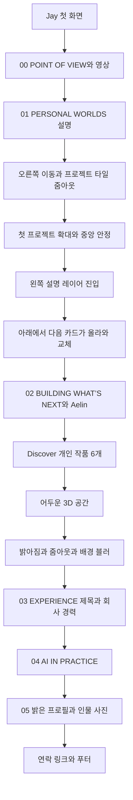

# Jay on Art 3차 리뉴얼 구현 매뉴얼

2026년 10월 13일. 작품 탐색을 타일 전경과 고정 카드 무대로 재구성하고, 개인 작품 이후 어두운 우주를 통과해 회사 경력으로 연결한다. 최종 인물 소개는 밝은 프로필 페이지로 마무리한다. 이번 문서는 구현 전 설계이며 현재 사이트의 구현 완료 기록이 아니다.

## 설계 기준과 해석

사용자가 제공한 다섯 이미지는 정지 구도 참조다. 실제 시간에 따른 동작, 원본 사이트의 렌더러나 스크롤 엔진은 이미지로 확인할 수 없다. 전환 동작은 사용자가 설명한 순서를 기준으로 설계한다. 참조 사이트 인물·문구·브랜드를 Jay의 실제 자료로 사용하지 않는다.

첫 타일 전경과 카드 무대는 회사 프로젝트 10개에 적용한다. Discover는 개인 작품 6개를 담은 독립 구간으로 02 이후, 03 직전에 둔다. 사용자가 지정하지 않은 02와 04의 본문·영상·워크플로우는 기존 기능을 유지하며 새 전환과 연결한다. 주 색조는 화이트·펄, 청록·라일락·산호이며 어두운 우주는 경력 진입을 위한 의도적인 대비 구간이다.

## 최종 장면 순서

Discover의 `(06)`은 작품 개수다. 장면 번호를 06으로 바꾸지 않는다. 메뉴와 페이지맵에 Discover를 별도 목적지로 추가하되 00–05의 기존 섹션 번호는 유지한다. 페이지맵은 실제 도달 가능한 지점을 표시하고 순서·카메라 경로와 일치해야 한다.

## 이미지 참조의 사용

| 참조 | 보관 파일 | 받아들일 요소 |
|---|---|---|
| 이미지 1 | docs/renewal-3/references/01-project-tiles.png | 여러 썸네일을 한 번에 보는 전경, 주목할 첫 타일의 강조 |
| 이미지 2 | docs/renewal-3/references/02-card-focus.png | 큰 카드 확대, 중심 정렬과 주변 카드의 맥락 |
| 이미지 3 | docs/renewal-3/references/03-card-settle.png | 중앙에 정착한 카드와 배경 여백, 절제된 원근 |
| 이미지 4 | docs/renewal-3/references/04-description-layer.png | 왼쪽 설명과 오른쪽 작품의 층위, 설명 진입 후 읽는 구간 |
| 이미지 5 | docs/renewal-3/references/05-profile-layout.png | 왼쪽 세로 사진과 오른쪽 소개의 비율·여백; Jay에는 밝은 배경 적용 |

위 이미지 파일은 내부 설계 참조로만 쓴다. 사이트의 작품 썸네일이나 사용자 프로필 사진으로 연결하지 않는다.

## 장면별 연출 계약

### 00에서 01 설명으로 이동

POINT OF VIEW의 기존 영상 확대를 마친 뒤 PERSONAL WORLDS의 제목과 설명을 읽을 수 있는 정착 구간을 둔다. 제목이 아직 읽히지 않았는데 타일로 넘어가지 않는다. 설명 퇴장, 오른쪽 공간 진입, 타일의 줌아웃을 하나의 연속 동작으로 연결한다.

세로 휠·트랙패드·터치 입력이 장면 진행을 담당한다. 브라우저 문서 자체의 가로 스크롤을 만들지 않는다. 데스크톱에서 01 설명 다음 구간의 카메라 또는 작품 무대가 오른쪽으로 이동했다는 공간적 변화가 명확해야 한다. 배경만 살짝 흔드는 변화로 대체하지 않는다.

### 타일 전경과 첫 카드 확대

회사 프로젝트 10개를 식별 가능한 타일로 보여준다. 넓은 화면의 권장 출발안은 3열 격자이며 작은 화면에서는 열 수를 줄인다. 기존 제목·회사·기간을 표시하고 실제 화면이 아닌 임시 콘셉트 표기를 유지한다. 전경에서 첫 타일을 강조하되 나머지가 존재한다는 맥락을 읽을 수 있어야 한다.

첫 프로젝트는 기존 순서의 마구마구다. 타일의 화면 위치와 확대 카드의 위치·이미지 크롭이 연결되어 같은 작품이 확대됐다고 느껴지게 한다. 다른 이미지를 갑자기 교체하거나 전체 타일 격자에서 독립 카드로 컷하지 않는다. 확대 과정의 이동량·원근·초점은 과감하게 쓸 수 있다. 정착 시에는 회전과 이동이 감쇠하며 작품 전체 구도가 안정된다.

### 중앙 카드와 왼쪽 설명

카드는 헤더·하단 고정 UI를 제외한 사용 가능 영역의 중앙에 먼저 위치한다. 설명 등장 전의 독립적인 중앙 정착 구간이 필요하다. 권장 출발 크기는 가용 화면 너비의 약 65–78%이며 이미지 비율과 화면 높이에 맞춰 조정한다. 수치는 공식 규격이나 고정 합격 기준이 아니다.

스크롤을 더 내리면 설명 레이어가 왼쪽 밖에서 진입한다. 카드가 약간 오른쪽으로 물러나거나 설명이 가장자리 일부를 겹칠 수 있지만, 핵심 작품과 본문이 가려지지 않아야 한다. 설명은 제목·회사·기간·기술·출시 상태 등 기존 확인 정보를 사용한다. 근거 없는 역할이나 성과 문구를 생성하지 않는다. 본문은 DOM 텍스트로 유지하고 배경의 색과 블러가 바뀌어도 충분한 대비를 제공한다.

### 다음 카드가 아래에서 올라오는 고정 무대

무대의 위치는 고정되고 현재 카드와 설명이 읽히는 상태를 유지한다. 다음 카드가 아래에서 올라오며 기존 카드를 위로 밀어낸다. 깊이·축소·그림자·겹침으로 카드 교체를 표현할 수 있다. 카드가 반쯤 바뀐 상태에서 설명만 다음 프로젝트로 바뀌는 오류를 방지한다.

각 프로젝트에는 정착·설명 읽기·교체 구간을 둔다. 예시 출발 비율은 해당 카드 진행의 0–20% 정착, 20–40% 설명 진입, 40–70% 읽기, 70–100% 다음 카드 교체다. 실제 글 길이와 이미지에 따라 조정한다. 마지막 카드에는 존재하지 않는 다음 카드나 긴 빈 여백을 만들지 않는다.

카드 순서는 마구마구, 오즈 크로니클, 마구더리얼, 이데아, 홈필드, 프로야구 H2·H3, SHOW ROOM, Home VR, Project D, MORAI다. 프로젝트 10개와 개인 작품 6개를 하나의 동일 경력 목록으로 합치지 않는다.

### Discover 이동과 어두운 우주 진입

Discover의 기존 개인 작품 6개와 ArtStation 원본 링크를 02 다음의 독립 장면으로 이동한다. 회사 프로젝트의 수직 카드 무대와 다른 개인 작품 탐색임을 제목·맥락으로 알린다. 큰 작품 카드가 스크롤에 따라 넘어가는 기존 Discover 방향을 유지하며 이번 이동에 필요한 시작·끝 전환을 정돈한다. Marakun의 상세 탐색과 기존 직접 링크도 보존한다.

Discover의 마지막 카드가 퇴장한 뒤 회사 이력 텍스트보다 어두운 3D 공간을 먼저 노출한다. 검은 덮개만 페이드하는 연출로 끝내지 않는다. 기존 우주 씬에서 행성·별·궤도의 깊이와 카메라 이동이 보이는 밤 공간을 마련한다. 짙은 남색·청록·보랏빛을 사용하고 잠깐의 원근 이동이나 행성 근접을 적용할 수 있다. 깜빡임·반복적인 섬광은 쓰지 않는다.

계속 스크롤하면 배경 조명과 색이 연속적으로 밝아지고 카메라가 줌아웃한다. 우주는 뒤로 물러나고 블러가 증가한다. 그 후 From imagined to real-time. 제목이 또렷한 전경으로 등장하며 회사 경력들이 자연스럽게 이어진다. 배경 블러를 텍스트·경력 DOM에 적용하지 않는다. 헤더와 고정 UI의 글자색도 장면 대비에 맞춰 동기화한다.

### 밝은 인물 프로필

05 진입의 Art. Systems. Connection. 대형 제목을 삭제하고 처음부터 사진과 소개가 함께 읽히게 한다. 데스크톱은 왼쪽 세로 사진, 오른쪽 소개·소속·링크를 배치한다. 배경은 화이트·펄이며 우주는 밀도를 낮추거나 뒤로 물러난다. 사진과 소개는 서로 다른 깊이에서 부드럽게 정착할 수 있다.

실제 사용자 사진이 없으므로 구현 시 가상 인물의 편집용 초상 이미지를 생성하는 것이 권장된다. 중립적인 스튜디오 조명, 단정한 상반신, 여백이 있는 3:4 또는 4:5 구도로 준비한다. 파일과 데이터에 placeholder 상태를 두고 화면에는 ‘임시 프로필 이미지 · 가상 인물 · 교체 예정’을 표시한다. 대체 텍스트에서도 최효재의 실제 사진이라고 설명하지 않는다. 이미지 5의 인물 사진은 복사하지 않는다. 최종 이미지 교체는 파일 경로·대체 텍스트·임시 표시를 함께 갱신하면 끝나도록 설계한다.

기존 최효재 소개와 YIGO. Creative Leader, LinkedIn·ArtStation·Resume 링크를 사용한다. Resume에는 YIGO. 대표이사 재직 사실을 유지한다. 새 경력·연락처·성과 수치를 만들지 않는다.

## 현재 코드에서 필요한 변경

현재 로컬 코드를 읽은 기준이다. 실제 Astra 착수 시 변경 상태를 다시 확인한다.

| 파일 | 현재 구조와 이번 변경 |
|---|---|
| index.html | 회사 프로젝트는 `.career-journey` 아래 10개 `.career-project`. Discover는 `#works` 안에 있다. 독립 Discover 장면과 경력 앞 전환을 만들고 회사 프로젝트에 타일·고정 카드 무대를 적용한다. |
| app.js | `sections` 순서, `index===2/3/4`, `wash`·`blur` 배열이 배경 상태에 연결된다. 섹션 이동에 따라 숫자의 의미가 달라진다. 의미 있는 장면 ID와 장면별 상태 정의로 재구성한다. |
| app.js | Discover 높이·track 이동, `offsetTop`, 카드 포커스, 페이지맵 현재 상태를 새 DOM 순서에 맞춘다. 일반 문서 위치와 고정 무대의 논리적 프로젝트 위치를 구분한다. |
| cosmos.js | 기존 Three.js 연속 배경과 카메라 경로를 확장한다. `setProgress` 입력과 의미 있는 장면 상태의 대응을 확인하고 오른쪽 진입·깊이 이동·밤 공간·경력 줌아웃을 연결한다. |
| renewal.css와 styles.css | 기존 프로젝트 교차 배치·Discover pin·테마 스타일의 충돌을 정리한다. 무대 높이, 원근, clipping, z-index와 모바일 대체 흐름을 일관되게 만든다. |
| cosmos.bundle.js | 생성 파일이다. cosmos.js 변경 후 기존 빌드로 갱신한다. |
| resume.html과 resume.css | 이번 요청의 재작성 대상은 아니다. 경력·정체성과 링크가 유지되는지 회귀 확인한다. |

기존 `#threshold`는 01→02 전환이다. 이를 경력 앞 전환으로 이동할지, 별도 전환을 추가하고 역할을 나눌지는 Astra가 선택할 수 있다. 두 전환을 쓴다면 각각의 목적·장면 ID·카메라 상태가 명확해야 한다. 긴 어두운 구간을 무의미하게 반복하지 않는다.

## 스크롤과 렌더링 설계

장면 진행의 원천을 하나로 두고 DOM 변환·카메라·테마·현재 카드 정보를 그 진행에서 계산한다. 프레임마다 누적 이동값을 더하는 방식보다 현재 스크롤 위치로 상태를 재구성하는 방식을 우선 검토한다. 역방향 스크롤, 큰 스크롤 점프와 재진입에서도 같은 결과가 나와야 한다.

타일→카드에는 같은 데이터와 이미지 크롭 기준을 사용한다. 하나의 DOM을 이동하거나 두 표현을 같은 위치·크기로 연결할 수 있다. 구현 방법은 자율적으로 선택하되 중복 텍스트가 스크린리더에 반복 노출되지 않게 한다. 현재 화면의 카드와 설명이 조작 가능하며, 가려진 카드 링크에 포커스가 갇히지 않게 한다.

카메라 이동은 사용자의 오른쪽 진입 인식과 일치해야 한다. Three.js 월드 좌표를 양수로 이동시키는 것만으로 오른쪽 화면 이동을 충족했다고 판단하지 않는다. DOM과 배경의 상대 이동을 실제 화면에서 확인한다. 마우스 포인터 반응은 작은 추가 움직임으로 유지하고 카드 정착과 읽기를 방해하지 않는다.

실제 WebGL 공간의 깊이와 HTML 작품 레이어를 함께 활용한다. 전체 페이지를 캔버스로 옮길 필요는 없다. 휠 기본 동작을 차단해 무한히 붙잡는 스크롤 구조를 피하고 정상적인 문서 끝과 링크 이동을 제공한다.

## 모바일과 모션 감소

모바일에서는 타일 개요→프로젝트 이미지와 설명→다음 프로젝트를 세로 흐름으로 읽을 수 있게 한다. 작은 화면에서 긴 핀·과도한 카메라 회전·좌우 패널을 강제하지 않는다. 설명은 이미지 아래에 배치하고 인물 프로필은 사진 다음에 소개가 오도록 쌓는다. 터치·키보드로 모든 작품과 링크에 도달해야 한다.

모션 감소·일시정지·정적 대체 화면에는 동일한 콘텐츠 순서와 식별 정보를 제공한다. 밤 공간은 짧은 정적 시각 전환으로 축약할 수 있다. 숨겨진 타일만 남거나 카드 transform 때문에 본문이 사라져서는 안 된다. breakpoint 전환과 창 크기 변경 시 현재 읽는 프로젝트를 가능한 한 유지한다.

## 자산과 성능

회사 프로젝트의 기존 임시 콘셉트를 타일과 카드에 재사용한다. 실제 개인 작품 6개는 실제 이미지·링크·외부 에셋 고지를 유지한다. 인물 슬롯만 새 임시 자산이 필요하며 이번 준비 단계에서는 생성하지 않는다. 동일 사진을 반복해서 다운로드하거나 10개 고해상도 이미지를 한꺼번에 디코딩하지 않는다.

시각 품질을 먼저 확보하고 프레임 안정성을 보고 입자 수, 해상도, 후처리와 블러 강도를 조정한다. 활동 중인 카드와 인접 카드 중심으로 애니메이션 비용을 제한한다. 화면 밖 영상은 정지하고 공개 Pages 경로에서 실제 파일 로딩과 사용자 재생을 확인한다. 이전 공개 확인에서는 영상 재생이 검증되지 않았으므로 이번 검증에서 해결할 항목으로 남긴다.

## 권장 구현 진행

1. 현재 Git 변경과 해당 코드·자산을 확인하고 이번 장면과 이전 지시의 충돌을 정리한다. 과거 문서 전체를 의무적으로 읽지 않는다.
2. 실제 첫 프로젝트로 타일 전경→중앙 정착→왼쪽 설명→두 번째 카드 교체를 연속 구현한다. 중간 시안을 사용자 승인 대기로 멈추지 않고 화면에서 결함을 고친다.
3. 프로젝트 10개에 확장하고 02·독립 Discover·경력 앞 어두운 전환을 연결한다. 장면 ID·페이지맵·직접 링크를 정리한다.
4. 프로필 이미지 슬롯과 밝은 레이아웃을 구현하고 모바일·정적 흐름을 완성한다.
5. 필요한 빌드를 실행한 뒤 아래 완료 기준을 실제 브라우저에서 확인한다. 실패한 부분을 고치고 영향받는 항목을 다시 확인한다.

## 완료 기준과 증거

| 확인 대상 | 합격 상태와 남길 증거 |
|---|---|
| 오른쪽 공간 이동 | 01 설명 다음에 타일 전경으로 연속 이동한다. 전후 캡처와 짧은 동작 기록. |
| 카드 집중 | 첫 타일과 확대 카드가 연결되고 중앙 정착이 설명보다 먼저 보인다. 타일·정착·설명 캡처. |
| 카드 교체 | 무대가 고정되고 다음 카드가 아래에서 올라와 기존 카드를 밀어낸다. 첫 두 카드와 마지막 카드의 동작 기록. |
| 데이터 동기화 | 카드 이미지·제목·설명·번호가 같은 프로젝트를 가리키며 10개에 도달한다. 역방향 스크롤도 일치한다. |
| Discover 위치 | 02→Discover→어두운 공간→03 순서다. 개인 작품 6개와 원본 링크가 유지된다. |
| 경력 전환 | 어두운 3D가 먼저 보이고 밝아짐·줌아웃·배경 블러 다음에 제목과 이력이 등장한다. 밤·밝아짐·경력 캡처. |
| 프로필 | Art. Systems. Connection.이 없어지고 밝은 사진·소개가 등장한다. 가상 인물 표시와 기존 링크 확인. |
| 적응형 화면 | 1440×900, 1920×1080, 390×844 출발 크기에서 텍스트 겹침·가로 넘침·고정 UI 가림이 없다. 실제 휴대전화 미확인 시 그 범위를 보고한다. |
| 탐색과 상태 | 휠·트랙패드, 역방향·빠른 스크롤, 중간 새로고침, 페이지맵·직접 해시, 키보드와 창 크기 변경이 안정적이다. |
| 대체 경로 | 모션 감소·일시정지·WebGL 실패·정적 보기에서도 같은 내용을 읽고 조작한다. |
| 영상과 링크 | 영상 로딩·재생·정지의 실제 결과, Resume와 ArtStation·LinkedIn 연결을 확인한다. 단순 HTML 존재를 재생 성공으로 보고하지 않는다. |

대표 캡처는 타일 전경, 중앙 카드, 설명 레이어, 다음 카드 교체, 어두운 공간, 경력 제목, 밝은 프로필, 모바일 카드·프로필이다. 성능 저하가 재현되면 환경과 장면을 기록하고 품질 조정을 수행한다. 새 테스트 프레임워크를 설치하는 것보다 실제 변경 동작을 확인하는 검증을 우선한다.

## 지시 우선순위와 공식 참고

이번 사용자 요청과 새 실행 지시서를 3차 연출 기준으로 사용한다. 기존 경력 자료는 사실 확인에, 생태적 우주 문서는 아트 방향에, 과거 리뉴얼 문서는 역사적 참고에 사용한다. 예전 ‘외부 공개 미실행’ 기록은 이미 공개 전환·Pages 배포가 완료된 현재 상태를 설명하지 않는다. 과거 승인 대기 문구를 이번 로컬 구현의 중단 사유로 사용하지 않는다.

[OpenAI의 Astra skills와 prompts 지침](https://developers.openai.com/blog/rethinking-skills-and-prompts-for-gpt-6-astra)은 중복·과도한 절차를 줄이고 필요한 참고를 조건부로 읽는 구조를 권장한다. 이를 첫 지시와 상세 매뉴얼의 분리에 적용했다. [GPT-6 prompting best practices](https://developers.openai.com/api/docs/guides/latest-model#prompting-best-practices)의 자율적인 완수, 지시 충돌 점검과 작업 규모에 맞는 검증을 이번 실행·완료 기준에 반영했다. 구체적인 페이지맵, 전환 비율과 화면 규격은 Jay 프로젝트의 설계 제안이다.
